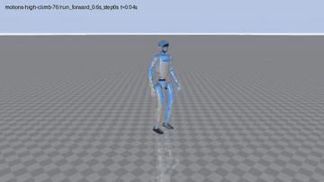

# proACP

**A GPU pipeline that teaches a humanoid to choose where to put its hands and feet on box terrain, and to carry the choice out**, on
mjlab / MuJoCo Warp. A contact **tracker** for the Unitree G1 follows the contact targets of 296 parkour clips (steps, 76 cm box
climbs, locomotion) with **4 of 296 clips failed**; a contact **planner** chooses those contacts itself, and the tracker driven by its
targets alone fails **8 of 296**. proACP re-implements *Humanoid Mobility via Attention-based Contacts* (arXiv:2610.31608) with
SuperMimic's differentiable world model instead of PPO (arXiv:2610.28480), builds on the mjlab port of
[`supermimic_vibed`](https://github.com/zita-ch/supermimic_vibed), and trains another humanoid from one robot file.

> **v0.0.0.** Stages 1 and 2 are trained and evaluated (one seed). **Stage 3 (procedural terrains) is implemented but not trained.**
> The per-run logs and checkpoints are not in the repository. See [CHANGELOG.md](CHANGELOG.md).



*Stage 2 tracker climbing 76 cm boxes on the planner's contact targets (training action noise σ = 0.1). Solid: the simulated G1;
translucent blue: the reference clip; spheres: the planner's targets. More animations in `media/`.*

| on 1× RTX PRO 5000 Blackwell, 296 PHP parkour clips | Stage 1 tracker | Stage 2 (planner targets) | Stage 3 |
|---|---|---|---|
| training time | 5.4 h | 0.7 h planner + 14.7 h co-training | not trained |
| normalized return | 0.835 | 0.56 (±2 s window, action noise) | — |
| failed clips (of 296) | 4 | 8 | — |
| contact placement error, feet (median, cm) | 10.0 / 10.2 | 4.2 / 3.9 | — |
| planner F1, feet / knees / hands (left) | — | 0.90 / 0.95 / 0.86 | — |

The tables per stage are in [`results/`](results/); read [How to read these numbers](#how-to-read-these-numbers) before quoting them.

## What proACP adds

- **Contact interface.** The tracker's command is the terrain point of the next contact of 9 bodies (feet, knees, hands, elbows,
  pelvis), a goal and a local height scan; contact is a differentiable signed-distance term on sphere-covered collision geoms.
- **Data.** Per-frame contact labels, and a whole-trajectory IK (`clips.refine`) that puts planted feet and palms on the surface.
- **Planner.** Trained offline on hindsight labels of the frozen tracker, then co-trained with it (`train.stage2`).
- **Procedural terrains** (9 types × 10 levels) for Stage 3, and a **robot interface**: `PROACP_ROBOT` selects a robot package.

The full list, and where it deviates from the contact paper, is in [docs/reference.md](docs/reference.md).

## Setup

Linux x86_64, an NVIDIA GPU with a CUDA 12.8 driver (reported runs: RTX PRO 5000 Blackwell; setup also tested on an H100),
[uv](https://docs.astral.sh/uv/getting-started/installation/), `git`, `curl`, `ffmpeg` (only for videos). About 3 GB of disk.

```bash
git clone https://github.com/researchseeehust/proACP.git && cd proACP
uv sync && source .venv/bin/activate      # mjlab 1.6.0, MuJoCo Warp, Warp 1.16, torch 2.11.0 (CUDA 12.8); or prefix commands with `uv run`
tools/download_data.sh                    # G1 description + the five PHP parkour bundles (sha256-checked) -> data/
python tools/test_env.py                  # sanity check: torch FK vs MuJoCo, motion files vs the robot
scripts/prepare_data.sh                   # contact labels, refined clips, their labels (about 10 minutes on 16 CPU workers)
```

The reported runs used torch 2.9.0; its Triton 3.5.0 fails to compile the policy-update kernels on an H100, so `uv.lock` pins torch
2.11.0. The numbers below come from torch 2.9.0. The motion data is not redistributed here (licenses below).

## Train and evaluate

`scripts/train.sh <command> <run> [flags]` runs one command into `logs/<run>/`. The reported runs (also `experiments/runs.txt`;
`scripts/reproduce_main.sh` runs them all, about 21 h on one GPU):

```bash
scripts/train.sh stage1 acp_stage1 --iterations 30000                                   # Stage 1, published clips (4.6 h)
scripts/train.sh stage1 acp_stage1_ft --init logs/acp_stage1/last.pt --motion_dir data/php_parkour_refined \
    --target_min_steps 4 --iterations 4000                                              # fine-tune on the refined clips (0.7 h)
scripts/train.sh planner_offline acp_planner_ft --tracker logs/acp_stage1_ft/ckpt_004000.pt   # the planner (0.7 h)
scripts/train.sh stage2 acp_stage2 --init logs/acp_stage1_ft/ckpt_004000.pt \
    --planner_init logs/acp_planner_ft/planner_020000.pt --iterations 24000             # co-training (14.7 h in total)
scripts/train.sh stage2 acp_stage2_tw --resume logs/acp_stage2/last.pt --term_window 2 --eta_rew_max 0.58 --iterations 40000

python -m proacp.evaluation.clips --ckpt logs/acp_stage1_ft/ckpt_004000.pt              # every clip once -> json next to the checkpoint
python -m proacp.evaluation.clips --ckpt logs/acp_stage2_tw/ckpt_040000.pt --planner logs/acp_stage2_tw/ckpt_040000.pt \
    --train_noise action [--record traj.npz]                                            # on the planner's targets
python tools/render.py traj.npz out.mp4 --per_folder 1                                  # a video of a recorded rollout
```

Stage 3 (`scripts/train.sh stage3 ...`, `proacp.evaluation.goals`) is implemented and not run. Flags and metrics:
[docs/reference.md](docs/reference.md).

## Results

| | run | return ↑ | failed (of 296) ↓ | other |
|---|---|---|---|---|
| Stage 1 | `acp_stage1_ft`, ckpt 4000 (30,000 iterations on the published clips + 4,000 on the refined ones) | 0.835 | 4 | touch P / R, feet 0.93 / 0.98, 0.91 / 0.98 |
| Stage 2 | `acp_stage2_tw`, ckpt 40000, planner targets, ±2 s window, action noise | 0.56 | 8 | planner F1 feet 0.90 / 0.89, knees 0.95 / 0.73, hands 0.86 / 0.92 |

Stage 1 per folder (fail rate): low step 0.018, high step 0, low climb 0, high climb 0.075, locomotion 0. Stage 2 fails on 10 % of the
high climbs, 7.5 % of the low climbs and at most 1 % of the other clips. The per-folder returns, the planner's position errors and the
24,000 checkpoint are in [`results/stage1.md`](results/stage1.md) and [`results/stage2.md`](results/stage2.md).

## How to read these numbers

- **Simulation only, exact perception, one seed**, no evaluation spread measured. MuJoCo Warp on the GPU is not bit-deterministic.
- **Evaluate Stage 2 with the training action noise.** Without it the same 40k checkpoint fails 165 of 296 clips (the Stage 1 tracker
  at 44k fails 170 instead of 7); noise on observations, targets or scans alone does not recover it. The cause is not identified, and
  it is the main risk for a deployment, where that noise is not added.
- **Later Stage 1 checkpoints evaluate worse** (8,000: 21 failed) although training statistics improve; the reported checkpoint
  (4000) was picked on that evaluation, which favours it.
- **Not comparable one to one with the paper**: different robot data, learner (no PPO baseline here) and terrains (boxes only).
- **Not run**: Stage 3 and every ablation (`--blind`, `--reward supermimic`, `--no-backward_curriculum`, `--term_window`), so nothing
  is claimed about which parts of the contact interface matter.

## Your own robot

A robot is one file that defines its model, link and joint order, PD gains and the links that play a role; `PROACP_ROBOT` selects it
(`g1`, a package `proacp/robots/<name>/`, a `.py` file or a module). Copy `src/proacp/robots/template/template_constants.py`, fill it
in, and check it:

```bash
python tools/check_robot.py --robot my_robot.py --motion_dir data/my_motions    # the declaration, the model, your motion files
PROACP_ROBOT=my_robot.py python tools/test_env.py --motion_dir data/my_motions  # torch FK vs MuJoCo, files vs the robot
```

You need an MJCF with hinge joints, a free root and collision geoms on the nine contact bodies, and motion clips in the PHP parkour
format (retargeting is outside proACP). **Only the G1 has been trained.** The names, the data format and what is still tuned for the
G1 are in [docs/reference.md](docs/reference.md#your-own-robot).

## Repository layout

| path | contents |
|---|---|
| `src/proacp/` | `train/` (stages, replay buffer), `evaluation/`, `tasks/` (reward, contact, goals), `models/` (networks, planner), `sim/` (simulator, terrain, FK), `clips/` (motion library, labels, refinement), `robot.py` and `robots/` (the G1, a template) |
| `tools/`, `scripts/` | data download, robot and FK checks, rendering; data preparation, training and reproduction scripts |
| `results/`, `experiments/`, `media/` | the result tables, the command lines of the reported runs, the animations |
| `docs/reference.md` | what proACP changes, deviations from the paper, flags, metrics, terrains, your own robot |
| `CHANGELOG.md`, `THIRD_PARTY_NOTICES.md` | release history; the upstream license notice and which modules derive from it |

## Attribution and license

proACP is an independent implementation, not affiliated with the authors of the papers. The code is released under the
[MIT License](LICENSE). Part of it is derived from [`supermimic_vibed`](https://github.com/zita-ch/supermimic_vibed) by Chong Zhang
(MIT, Copyright (c) 2026 ETH Zurich, Chong Zhang); its notice and the per-module overlap are in
[THIRD_PARTY_NOTICES.md](THIRD_PARTY_NOTICES.md).

Built on [mjlab](https://github.com/mujocolab/mjlab), [MuJoCo](https://mujoco.org), [MuJoCo Warp](https://github.com/google-deepmind/mujoco_warp),
[NVIDIA Warp](https://github.com/NVIDIA/warp) (Apache-2.0) and [PyTorch](https://pytorch.org) (BSD-3-Clause), used unmodified. Data:
the [PHP parkour](https://github.com/amazon-far/php_parkour) G1 bundles (check their own terms) and the Unitree G1 description
(BSD-3-Clause, via `lvhaidong/LAFAN1_Retargeting_Dataset`); the data is **not redistributed**, and the animations in `media/`, renders of
the PHP clips, are **not covered by the MIT license**.

## Citation

```bibtex
@misc{proacp2026,
  title  = {proACP: Contact-Planned Whole-Body Mobility for Humanoids on mjlab},
  author = {{proACP contributors}}, year = {2026}, version = {0.0.0},
  url    = {https://github.com/researchseeehust/proACP}
}
@article{he2026attentioncontacts,
  title   = {Humanoid Mobility via Attention-based Contacts},
  author  = {He, Junzhe and Wen, Kehan and Zhang, Chong and Schwarke, Clemens and Zhang, Zewei and Qu, Kaixian and Hu, Siyuan and M{\"u}ller, Matthias and Koltun, Vladlen and Hutter, Marco},
  journal = {arXiv preprint arXiv:2610.31608}, year = {2026}
}
@article{liao2026supermimic,
  title   = {SuperMimic: Scaling Humanoid Whole-Body Control with One Differentiable World Model},
  author  = {Liao, Qiayuan and Shao, Yiyang and Long, Junfeng and Zakka, Kevin and Horowitz, Roberto and Abbeel, Pieter and Sreenath, Koushil},
  journal = {arXiv preprint arXiv:2610.28480}, year = {2026}
}
```
